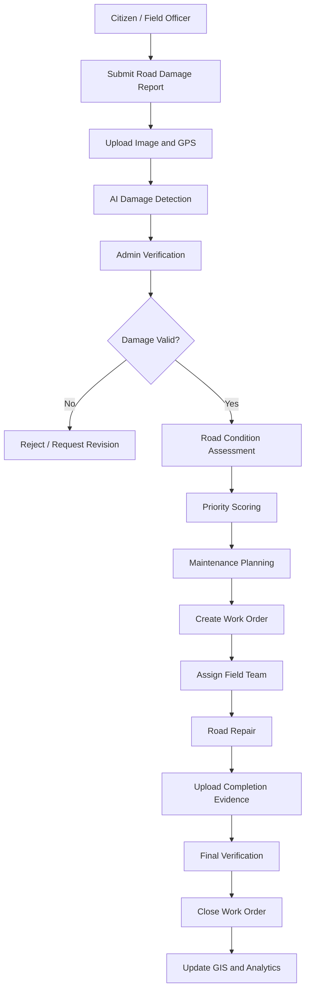
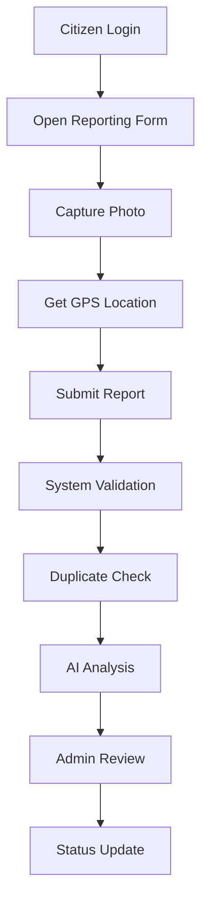
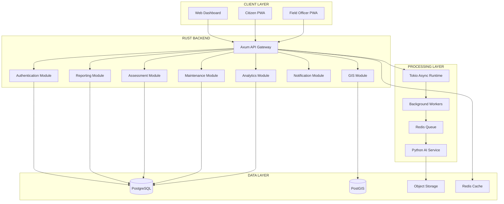

# PRODUCT REQUIREMENTS DOCUMENT (PRD)
# ROADCARE
### Intelligent Road Infrastructure Monitoring & Management System

**Version:** 1.0.0  
**Document Status:** Initial Product Specification  
**Year:** 2026  
**Product Category:** Smart City – Transportation & Infrastructure  
**Platform:** Web Application + Progressive Web Application (PWA)  
**Backend:** Rust  
**Database:** PostgreSQL + PostGIS  
**Architecture:** Modular Monolith with Service-Oriented AI Integration  

---

# IDENTITAS DOKUMEN

| Identitas | Keterangan |
|---|---|
| Nama Produk | RoadCare |
| Jenis Sistem | Intelligent Road Infrastructure Monitoring System |
| Versi Dokumen | 1.0.0 |
| Tahun Pengembangan | 2026 |
| Backend | Rust (Axum Framework) |
| Database | PostgreSQL + PostGIS |
| Frontend | Next.js / React |
| AI Engine | Python + YOLO + OpenCV |
| Target Pengguna | Pemerintah Daerah, Petugas Lapangan, Masyarakat |
| Status | Draft PRD |

## IDENTITAS INSTANSI

| Pemerintah Daerah | Universitas Teknokrat Indonesia |
|---|---|
| **[SPACE FOR LOGO PEMERINTAH DAERAH]** | **[SPACE FOR LOGO UNIVERSITAS TEKNOKRAT INDONESIA]** |
| Nama Pemerintah Daerah | Universitas Teknokrat Indonesia |
| Instansi Pengelola | Dinas PUPR / Bina Marga |

---

# DAFTAR ISI

1. Product Overview
2. Background & Problem Statement
3. Product Vision & Mission
4. Product Objectives
5. Target Users & Stakeholders
6. Product Scope
7. User Roles & Permissions
8. Functional Requirements
9. AI Road Damage Detection
10. GIS & Spatial Intelligence
11. Road Priority Assessment
12. Maintenance Management
13. System Workflow
14. Non-Functional Requirements
15. System Architecture
16. Technology Stack
17. Database Architecture
18. API Requirements
19. Security & Data Governance
20. UI/UX Requirements
21. Dashboard Requirements
22. Development Roadmap
23. MVP Requirements
24. Success Metrics (KPI)
25. Risks & Mitigation
26. Future Development
27. Acceptance Criteria
28. Conclusion

---

# 1. PRODUCT OVERVIEW

## 1.1 Product Description

RoadCare adalah platform digital berbasis Geographic Information System (GIS), Artificial Intelligence (AI), dan teknologi pemrosesan data spasial yang dirancang untuk memantau, mendeteksi, memetakan, menganalisis, serta mengelola kondisi infrastruktur jalan secara terintegrasi.

RoadCare menghubungkan masyarakat, petugas lapangan, administrator dinas, dan pemerintah daerah dalam satu ekosistem pengelolaan infrastruktur jalan.

Platform ini memungkinkan pemerintah mendapatkan informasi kondisi jalan secara lebih cepat, akurat, transparan, dan terukur.

RoadCare tidak hanya berfungsi sebagai aplikasi pelaporan jalan rusak, tetapi juga sebagai sistem manajemen infrastruktur yang mendukung proses pengambilan keputusan pemerintah daerah.

## 1.2 Core Concept

RoadCare dibangun berdasarkan empat pilar utama:

1. **Detection:** Mengidentifikasi kerusakan jalan melalui AI dan pelaporan masyarakat.
2. **Mapping:** Memetakan kondisi jalan menggunakan GIS dan data koordinat.
3. **Assessment:** Menganalisis tingkat kerusakan dan menentukan prioritas perbaikan.
4. **Management:** Mengelola pekerjaan perbaikan, anggaran, dan evaluasi infrastruktur.

## 1.3 Product Positioning

RoadCare diposisikan sebagai:

> An Intelligent Infrastructure Management Platform that transforms road monitoring, damage detection, and maintenance operations into a unified, data-driven smart city ecosystem.

---

# 2. BACKGROUND & PROBLEM STATEMENT

## 2.1 Background

Infrastruktur jalan merupakan salah satu komponen penting dalam mendukung mobilitas masyarakat dan pertumbuhan ekonomi daerah.

Namun, pengelolaan infrastruktur jalan masih menghadapi berbagai tantangan, seperti:

- Data kondisi jalan belum terintegrasi.
- Pelaporan kerusakan masih dilakukan secara manual.
- Proses inspeksi membutuhkan waktu dan sumber daya.
- Tidak tersedianya pemetaan kerusakan secara menyeluruh.
- Prioritas perbaikan belum sepenuhnya berbasis data.
- Monitoring progres perbaikan belum terpusat.
- Dokumentasi sebelum dan sesudah perbaikan tidak selalu terdigitalisasi.

RoadCare hadir untuk membantu mengatasi permasalahan tersebut melalui sistem digital terintegrasi.

## 2.2 Problem Statement

| No. | Permasalahan | Dampak |
|---|---|---|
| 1 | Tidak adanya database kondisi jalan terpusat | Data sulit dianalisis |
| 2 | Pelaporan kerusakan manual | Penanganan lambat |
| 3 | Tidak ada deteksi otomatis | Inspeksi membutuhkan banyak tenaga |
| 4 | Tidak ada prioritas penanganan terukur | Alokasi sumber daya kurang optimal |
| 5 | Monitoring perbaikan belum terintegrasi | Progres sulit dipantau |
| 6 | Dokumentasi tidak terstruktur | Evaluasi sulit dilakukan |
| 7 | Data anggaran terpisah dari pekerjaan | Akuntabilitas sulit dievaluasi |

---

# 3. PRODUCT VISION & MISSION

## 3.1 Vision

Menjadi platform manajemen infrastruktur jalan yang cerdas, terintegrasi, transparan, dan berbasis data untuk mendukung pembangunan Smart City di Indonesia.

## 3.2 Mission

1. Mendigitalisasi proses monitoring infrastruktur jalan.
2. Mengintegrasikan laporan kerusakan dari masyarakat dan petugas.
3. Memanfaatkan AI untuk mendeteksi kerusakan jalan.
4. Menyediakan pemetaan kondisi jalan berbasis GIS.
5. Mengoptimalkan prioritas pemeliharaan jalan.
6. Meningkatkan transparansi proses perbaikan infrastruktur.
7. Mendukung pemerintah dalam pengambilan keputusan berbasis data.

---

# 4. PRODUCT OBJECTIVES

Tujuan utama RoadCare:

- Memusatkan seluruh data kondisi jalan dalam satu sistem.
- Mempercepat proses identifikasi kerusakan.
- Mengurangi duplikasi laporan kerusakan.
- Menyediakan sistem klasifikasi kerusakan otomatis.
- Menentukan prioritas penanganan berdasarkan indikator terukur.
- Meningkatkan efektivitas pengelolaan pekerjaan perbaikan.
- Menyediakan laporan kinerja infrastruktur secara real-time atau mendekati real-time.
- Meningkatkan partisipasi masyarakat.

## 4.1 Product Goals

| Goal | Indikator |
|---|---|
| Digitalisasi laporan | Seluruh laporan tercatat dalam sistem |
| Efisiensi inspeksi | Waktu verifikasi lebih terukur |
| Akurasi pemetaan | Lokasi kerusakan memiliki koordinat |
| Prioritas berbasis data | Tersedia skor prioritas |
| Transparansi pekerjaan | Progres pekerjaan dapat dilacak |
| Evaluasi infrastruktur | Tersedia histori kondisi dan perbaikan |

Target kuantitatif akan ditetapkan setelah baseline operasional dan pilot project tersedia.

---

# 5. TARGET USERS & STAKEHOLDERS

RoadCare memiliki empat kelompok pengguna utama.

## 5.1 Citizen (Masyarakat)

Pengguna yang dapat melaporkan kondisi jalan.

Kebutuhan:
- Melaporkan jalan rusak.
- Mengunggah foto atau video.
- Mengirimkan lokasi kerusakan.
- Memantau status laporan.
- Menerima informasi tindak lanjut.

## 5.2 Field Officer (Petugas Lapangan)

Petugas yang bertanggung jawab melakukan pemeriksaan dan dokumentasi kondisi jalan.

Kebutuhan:
- Menerima tugas inspeksi.
- Melihat lokasi kerusakan.
- Memverifikasi laporan.
- Mengunggah bukti pemeriksaan.
- Memperbarui kondisi jalan.
- Mendokumentasikan pekerjaan.

## 5.3 Department Administrator (Admin Dinas)

Administrator yang mengelola operasional RoadCare.

Kebutuhan:
- Mengelola laporan.
- Memverifikasi data.
- Menentukan prioritas.
- Menugaskan petugas.
- Membuat work order.
- Memantau progres pekerjaan.
- Mengelola data infrastruktur.

## 5.4 Executive / Government (Pimpinan Pemerintah)

Pengguna yang berfokus pada pengawasan dan pengambilan keputusan.

Kebutuhan:
- Melihat kondisi jalan daerah.
- Memantau statistik kerusakan.
- Melihat distribusi kerusakan.
- Mengevaluasi kinerja dinas.
- Memantau anggaran pekerjaan.
- Mengakses laporan strategis.

---

# 6. PRODUCT SCOPE

## 6.1 In Scope

Fitur yang termasuk dalam pengembangan RoadCare:

1. Authentication & Authorization.
2. Citizen Reporting.
3. Road Infrastructure Database.
4. GIS Road Mapping.
5. AI Road Damage Detection.
6. Road Condition Assessment.
7. Priority Scoring.
8. Inspection Management.
9. Maintenance Management.
10. Work Order Management.
11. Executive Dashboard.
12. Notification System.
13. Reporting & Analytics.
14. Audit Trail.

## 6.2 Out of Scope (Initial Release)

Fitur yang belum menjadi bagian dari MVP:

- Integrasi langsung dengan seluruh CCTV pemerintah.
- Autonomous road inspection vehicles.
- IoT sensor network skala kota.
- Prediksi kerusakan seluruh ruas jalan menggunakan Digital Twin.
- Integrasi otomatis seluruh sistem keuangan daerah.
- Penentuan pencairan anggaran secara otomatis.

Fitur tersebut dapat dikembangkan pada fase berikutnya.

---

# 7. USER ROLES & PERMISSIONS

RoadCare menggunakan Role-Based Access Control (RBAC).

| Modul | Citizen | Field Officer | Admin Dinas | Executive |
|---|---|---|---|---|
| Melaporkan Kerusakan | Yes | Yes | Yes | No |
| Melihat Peta Jalan | Yes | Yes | Yes | Yes |
| Melihat Laporan Publik | Yes | Yes | Yes | Yes |
| Verifikasi Kerusakan | No | Yes | Yes | No |
| Inspeksi Lapangan | No | Yes | Yes | No |
| Mengelola Work Order | No | Limited | Yes | Read Only |
| Menentukan Prioritas | No | Recommend | Yes | Read Only |
| Monitoring Pekerjaan | Own Report | Assigned Task | Yes | Yes |
| Monitoring Anggaran | No | No | Yes | Yes |
| Executive Analytics | No | No | Yes | Yes |
| Manajemen Pengguna | No | No | Yes | No |

Hak akses harus dapat dibatasi berdasarkan wilayah kerja dan instansi.

---

# 8. FUNCTIONAL REQUIREMENTS

## FR-01: Authentication & User Management

Sistem harus menyediakan mekanisme autentikasi dan pengelolaan pengguna.

Fitur:

- Registrasi masyarakat.
- Login dan logout.
- Password hashing.
- Reset password.
- Manajemen profil.
- Role-Based Access Control.
- Session management.
- Account activation dan deactivation.

Acceptance Criteria:

- Pengguna hanya dapat mengakses fitur sesuai role.
- Password tidak disimpan dalam bentuk plaintext.
- Sistem mencatat aktivitas autentikasi.
- Akun yang dinonaktifkan tidak dapat melakukan login.

## FR-02: Citizen Reporting

Sistem harus menyediakan fasilitas pelaporan kerusakan jalan.

Fitur:

- Form pelaporan kerusakan.
- Upload foto dan video.
- GPS geolocation.
- Input deskripsi.
- Pemilihan jenis kerusakan.
- Timestamp otomatis.
- Tracking status laporan.

Data laporan:

| Field | Type |
|---|---|
| Report ID | UUID |
| User ID | UUID |
| Road Segment ID | UUID / Nullable |
| Latitude | DOUBLE PRECISION |
| Longitude | DOUBLE PRECISION |
| Description | TEXT |
| Damage Type | ENUM / Reference |
| Photo URL | TEXT |
| Status | ENUM |
| Created At | TIMESTAMPTZ |

Acceptance Criteria:

- Setiap laporan memiliki ID unik.
- Lokasi laporan harus valid.
- Foto harus melewati validasi ukuran dan format.
- Pengguna dapat melihat status laporan miliknya.

## FR-03: AI Road Damage Detection

Sistem harus dapat menganalisis gambar untuk mengidentifikasi kerusakan jalan.

Fitur:

- Upload gambar.
- Image preprocessing.
- Object detection.
- Damage classification.
- Confidence score.
- Bounding box visualization.
- Detection history.
- Manual verification.

Jenis kerusakan:

1. Pothole.
2. Longitudinal Crack.
3. Transverse Crack.
4. Alligator Crack.
5. Surface Damage.
6. Rutting.

Acceptance Criteria:

- AI memberikan hasil deteksi dan confidence score.
- Sistem menyimpan versi model yang digunakan.
- Hasil AI dapat diperiksa petugas.
- Deteksi tidak otomatis dianggap sebagai kerusakan terverifikasi.

## FR-04: GIS Road Mapping

Sistem harus menampilkan data infrastruktur jalan dalam peta interaktif.

Fitur:

- Road segment mapping.
- Damage point mapping.
- Geographic filtering.
- Severity visualization.
- District filtering.
- Road condition details.
- Historical damage mapping.

Acceptance Criteria:

- Setiap titik kerusakan memiliki koordinat.
- Data dapat difilter berdasarkan wilayah.
- Peta dapat menampilkan informasi detail kerusakan.
- Data spasial menggunakan PostgreSQL + PostGIS.

## FR-05: Road Condition Assessment

Sistem harus memberikan penilaian kondisi jalan.

Fitur:

- Damage severity classification.
- Road condition scoring.
- Traffic impact assessment.
- Safety risk assessment.
- Road importance assessment.
- Priority recommendation.

Klasifikasi awal:

| Severity | Score |
|---|---|
| Good | 0–20 |
| Minor | 21–40 |
| Moderate | 41–60 |
| Severe | 61–80 |
| Critical | 81–100 |

Skor tersebut merupakan rancangan awal untuk RoadCare dan perlu disesuaikan dengan standar inspeksi teknis yang digunakan instansi.

## FR-06: Priority Assessment

Sistem harus menghitung tingkat prioritas perbaikan.

Rumus awal:

Priority Score:

P = (D × 0.35) + (T × 0.25) + (S × 0.25) + (I × 0.15)

Keterangan:

- D = Damage Severity.
- T = Traffic Volume.
- S = Safety Risk.
- I = Road Importance.

Kategori:

| Score | Priority |
|---|---|
| 80–100 | Critical |
| 60–79 | High |
| 40–59 | Medium |
| 0–39 | Low |

Admin dapat meninjau dan mengubah rekomendasi dengan alasan yang tercatat dalam audit log.

## FR-07: Inspection Management

Sistem harus menyediakan pengelolaan inspeksi lapangan.

Fitur:

- Membuat jadwal inspeksi.
- Assign petugas.
- Melihat lokasi inspeksi.
- Upload dokumentasi.
- Input hasil inspeksi.
- Memperbarui kondisi jalan.
- Menyimpan histori inspeksi.

## FR-08: Maintenance Management

Sistem harus mengelola aktivitas perbaikan jalan.

Fitur:

- Create maintenance request.
- Generate work order.
- Assign maintenance team.
- Work scheduling.
- Cost estimation.
- Progress tracking.
- Before-after documentation.
- Completion verification.

Status pekerjaan:

1. Draft.
2. Approved.
3. Scheduled.
4. In Progress.
5. Pending.
6. Completed.
7. Verified.
8. Closed.

## FR-09: Executive Dashboard

Sistem harus menyediakan dashboard untuk pimpinan pemerintah.

Fitur:

- Total road segments.
- Total damage reports.
- Verified damage.
- Critical road conditions.
- Maintenance progress.
- Regional damage distribution.
- Maintenance budget monitoring.
- Performance analytics.

## FR-10: Notification System

Sistem harus memberikan notifikasi berdasarkan perubahan status.

Channel:

- In-app notification.
- Email (opsional).
- Push notification PWA.
- SMS gateway (opsional).

Event:

- Laporan diterima.
- Laporan diverifikasi.
- Petugas ditugaskan.
- Perbaikan dimulai.
- Perbaikan selesai.
- Laporan ditutup.

## FR-11: Reporting & Analytics

Sistem harus menyediakan laporan operasional dan strategis.

Fitur:

- Export PDF.
- Export Excel.
- Damage statistics.
- Maintenance reports.
- Regional comparisons.
- Monthly reports.
- Yearly reports.
- Historical analysis.

## FR-12: Audit Trail

Sistem harus mencatat aktivitas penting.

Data yang dicatat:

- User ID.
- Action.
- Resource type.
- Resource ID.
- Timestamp.
- IP address (sesuai kebutuhan keamanan).
- Previous value.
- New value.

Audit log tidak boleh dapat diubah melalui antarmuka operasional biasa.

---

# 9. AI ROAD DAMAGE DETECTION

## 9.1 AI Architecture

AI Engine dipisahkan dari backend utama Rust.

Arsitektur:

- Rust API menerima permintaan analisis.
- File disimpan pada object storage.
- Background job dikirim ke processing queue.
- Python AI service menjalankan model YOLO.
- Hasil deteksi dikirim kembali ke Rust API.
- Hasil disimpan ke PostgreSQL.

## 9.2 AI Processing Pipeline

1. Image Upload.
2. File Validation.
3. Image Preprocessing.
4. Object Detection.
5. Damage Classification.
6. Confidence Scoring.
7. Bounding Box Generation.
8. Result Storage.
9. Human Verification.

## 9.3 AI Detection Result

Contoh struktur hasil:

```json
{
  "detection_id": "uuid",
  "damage_type": "pothole",
  "confidence": 0.94,
  "bounding_box": {
    "x": 120,
    "y": 80,
    "width": 250,
    "height": 180
  },
  "model_version": "roadcare-yolo-v1",
  "verification_status": "pending"
}
```

## 9.4 AI Model Requirements

- Model dapat diperbarui tanpa mengganti backend utama.
- Model memiliki versioning.
- Confidence threshold dapat dikonfigurasi.
- Hasil deteksi dapat ditinjau manusia.
- Dataset pelatihan harus memiliki anotasi yang konsisten.
- Evaluasi menggunakan Precision, Recall, F1-Score, dan mAP.
- Sistem tidak boleh menganggap confidence score sebagai ukuran tingkat keparahan kerusakan.

---

# 10. GIS & SPATIAL INTELLIGENCE

## 10.1 GIS Requirements

RoadCare menggunakan PostGIS sebagai spatial database.

Fitur:

- Point geometry untuk lokasi kerusakan.
- LineString geometry untuk ruas jalan.
- Polygon geometry untuk wilayah administrasi.
- Spatial filtering.
- Distance calculation.
- Spatial clustering.
- Geographic aggregation.

## 10.2 Spatial Reference System

Gunakan:

- SRID 4326 untuk koordinat geografis GPS.
- SRID 3857 jika diperlukan untuk visualisasi Web Mercator.
- Sistem proyeksi lokal yang sesuai untuk pengukuran jarak dan luas.

## 10.3 GIS Data Sources

Sumber data yang dapat digunakan:

- OpenStreetMap.
- Data jaringan jalan pemerintah.
- Data batas administrasi.
- Hasil survei lapangan.
- Laporan masyarakat.

Sumber data harus memiliki metadata dan kejelasan lisensi penggunaan.

---

# 11. ROAD PRIORITY ASSESSMENT

## 11.1 Assessment Indicators

RoadCare menggunakan beberapa indikator untuk menghitung prioritas perbaikan.

| Indicator | Weight |
|---|---:|
| Damage Severity | 35% |
| Traffic Volume | 25% |
| Safety Risk | 25% |
| Road Importance | 15% |
| Total | 100% |

## 11.2 Assessment Workflow

1. Sistem menerima data kerusakan.
2. Petugas memverifikasi kondisi.
3. Sistem mengambil data pendukung.
4. Sistem menghitung skor.
5. Sistem menghasilkan rekomendasi prioritas.
6. Admin meninjau rekomendasi.
7. Prioritas disetujui untuk penanganan.

## 11.3 Assessment Rules

- Data yang belum diverifikasi tidak boleh menjadi dasar tunggal keputusan perbaikan.
- Nilai indikator harus memiliki sumber data.
- Admin dapat melakukan override.
- Override harus disertai alasan.
- Perubahan bobot harus tercatat dalam audit log.
- Skor tidak menggantikan inspeksi teknis.

---

# 12. MAINTENANCE MANAGEMENT

## 12.1 Work Order Management

Setiap pekerjaan perbaikan harus memiliki Work Order.

Data Work Order:

| Field | Description |
|---|---|
| Work Order ID | Unique identifier |
| Road Segment | Target ruas jalan |
| Damage Reference | Referensi kerusakan |
| Assigned Team | Tim pelaksana |
| Planned Start | Jadwal mulai |
| Planned Finish | Target selesai |
| Estimated Cost | Estimasi biaya |
| Actual Cost | Biaya aktual |
| Work Status | Status pekerjaan |
| Completion Evidence | Dokumentasi pekerjaan |

## 12.2 Maintenance Documentation

Setiap pekerjaan harus memiliki:

- Foto sebelum perbaikan.
- Foto selama perbaikan.
- Foto setelah perbaikan.
- Lokasi pekerjaan.
- Waktu pekerjaan.
- Petugas pelaksana.
- Catatan hasil pekerjaan.

## 12.3 Completion Verification

Pekerjaan tidak otomatis dianggap selesai hanya karena petugas mengubah status menjadi Completed.

Admin atau petugas verifikator harus memeriksa bukti penyelesaian sebelum status menjadi Verified atau Closed.

---

# 13. SYSTEM WORKFLOW

## 13.1 Main Workflow



## 13.2 Reporting Workflow



---

# 14. NON-FUNCTIONAL REQUIREMENTS

## 14.1 Performance

- API response target p95 maksimal 500 ms untuk operasi baca sederhana pada kondisi beban yang disepakati.
- Proses AI berjalan secara asynchronous.
- Spatial query harus menggunakan spatial index.
- Pagination wajib diterapkan pada data berjumlah besar.
- Dashboard menggunakan agregasi data yang efisien.

Target performa harus divalidasi melalui load testing.

## 14.2 Availability

- Target availability awal: 99,5% per bulan.
- Backup database otomatis.
- Monitoring server.
- Error logging.
- Health check endpoint.

## 14.3 Scalability

- Mendukung pertumbuhan jumlah pengguna.
- Mendukung penambahan wilayah administrasi.
- Mendukung pertumbuhan data spasial.
- Mendukung penambahan service AI.
- Mendukung horizontal scaling jika dibutuhkan.

## 14.4 Reliability

- Database transaction.
- Foreign key constraints.
- Retry mechanism.
- Idempotent API untuk operasi yang memerlukannya.
- Background job monitoring.

## 14.5 Maintainability

- Modular codebase.
- Unit testing.
- Integration testing.
- API documentation.
- Structured logging.
- Version control.
- Automated deployment pipeline.

---

# 15. SYSTEM ARCHITECTURE

## 15.1 Architecture Overview

RoadCare menggunakan pendekatan Modular Monolith pada backend Rust untuk menjaga kompleksitas awal tetap terkendali.

Service AI menggunakan Python secara terpisah.



## 15.2 Backend Architecture

Backend utama wajib menggunakan Rust.

Framework dan library yang direkomendasikan:

| Component | Technology |
|---|---|
| Programming Language | Rust |
| Web Framework | Axum |
| Async Runtime | Tokio |
| Database Access | SQLx |
| Serialization | Serde |
| Authentication | JWT |
| Password Hashing | Argon2id |
| Validation | Validator |
| Error Handling | Anyhow / Thiserror |
| Logging | Tracing |
| API Documentation | OpenAPI / Utoipa |
| Configuration | Config / Environment Variables |
| Background Processing | Tokio Workers + Redis Queue |

## 15.3 Rust Backend Design Principles

- Menggunakan asynchronous I/O.
- Memisahkan business logic dari HTTP handlers.
- Menggunakan typed models dan DTO.
- Menghindari penggunaan raw SQL yang tidak terkontrol.
- Menggunakan SQLx compile-time checked queries jika memungkinkan.
- Menerapkan database transactions untuk operasi kritis.
- Memanfaatkan Rust ownership dan type safety.
- Menyediakan centralized error handling.

---

# 16. TECHNOLOGY STACK

## 16.1 Frontend

| Component | Technology |
|---|---|
| Framework | Next.js |
| Language | TypeScript |
| Styling | Tailwind CSS |
| Component UI | shadcn/ui |
| Map | MapLibre GL JS |
| Chart | Apache ECharts |
| State Management | Zustand |
| Data Fetching | TanStack Query |
| Form Validation | Zod |
| PWA | Service Worker |

## 16.2 Backend

| Component | Technology |
|---|---|
| Language | Rust |
| Framework | Axum |
| Runtime | Tokio |
| Database Driver | SQLx |
| API Style | REST API |
| API Documentation | OpenAPI |
| Authentication | JWT |
| Hashing | Argon2id |

## 16.3 Database

| Component | Technology |
|---|---|
| Primary Database | PostgreSQL |
| Spatial Extension | PostGIS |
| Migration | SQLx Migrate |
| Connection Pool | SQLx |
| Cache | Redis |
| File Storage | S3-Compatible Storage |

## 16.4 AI & Machine Learning

| Component | Technology |
|---|---|
| Language | Python |
| Object Detection | YOLO |
| Image Processing | OpenCV |
| Deep Learning | PyTorch |
| Model Serving | FastAPI |
| Model Evaluation | MLflow / Evaluation Pipeline |

## 16.5 Infrastructure

| Component | Technology |
|---|---|
| Containerization | Docker |
| Reverse Proxy | Nginx |
| OS | Ubuntu Server / Linux |
| CI/CD | GitHub Actions |
| Monitoring | Prometheus + Grafana |
| Error Tracking | Sentry / OpenTelemetry |
| Backup | PostgreSQL Backup + Object Storage |

---

# 17. DATABASE ARCHITECTURE

## 17.1 Database Design Principles

RoadCare menggunakan PostgreSQL sebagai primary relational database dan PostGIS untuk pengelolaan data spasial.

Prinsip:

- UUID sebagai primary identifier.
- Foreign key untuk menjaga integritas relasi.
- TIMESTAMPTZ untuk timestamp.
- JSONB hanya untuk metadata yang fleksibel.
- Geometry untuk data spasial.
- Spatial indexing menggunakan GiST.
- Database normalization.
- Soft delete hanya untuk entitas yang memang membutuhkan pemulihan data.
- Audit trail untuk aktivitas penting.

## 17.2 Core Database Tables

### 1. users

| Field | Type |
|---|---|
| id | UUID |
| full_name | VARCHAR |
| email | VARCHAR |
| phone | VARCHAR |
| password_hash | TEXT |
| role_id | UUID |
| organization_id | UUID |
| is_active | BOOLEAN |
| created_at | TIMESTAMPTZ |
| updated_at | TIMESTAMPTZ |

### 2. roles

| Field | Type |
|---|---|
| id | UUID |
| name | VARCHAR |
| description | TEXT |

### 3. organizations

| Field | Type |
|---|---|
| id | UUID |
| name | VARCHAR |
| organization_type | VARCHAR |
| parent_id | UUID |
| created_at | TIMESTAMPTZ |

### 4. administrative_areas

| Field | Type |
|---|---|
| id | UUID |
| name | VARCHAR |
| area_type | VARCHAR |
| parent_id | UUID |
| boundary | GEOMETRY(MULTIPOLYGON, 4326) |

### 5. road_segments

| Field | Type |
|---|---|
| id | UUID |
| road_name | VARCHAR |
| road_code | VARCHAR |
| road_class | VARCHAR |
| road_status | VARCHAR |
| surface_type | VARCHAR |
| length_meters | DOUBLE PRECISION |
| width_meters | DOUBLE PRECISION |
| administrative_area_id | UUID |
| geometry | GEOMETRY(LINESTRING, 4326) |
| created_at | TIMESTAMPTZ |
| updated_at | TIMESTAMPTZ |

### 6. damage_reports

| Field | Type |
|---|---|
| id | UUID |
| reporter_id | UUID |
| road_segment_id | UUID |
| damage_type_id | UUID |
| description | TEXT |
| location | GEOMETRY(POINT, 4326) |
| status | VARCHAR |
| reported_at | TIMESTAMPTZ |
| created_at | TIMESTAMPTZ |

### 7. damage_types

| Field | Type |
|---|---|
| id | UUID |
| name | VARCHAR |
| description | TEXT |

### 8. media_files

| Field | Type |
|---|---|
| id | UUID |
| report_id | UUID |
| storage_key | TEXT |
| file_type | VARCHAR |
| file_size | BIGINT |
| uploaded_by | UUID |
| created_at | TIMESTAMPTZ |

### 9. ai_detections

| Field | Type |
|---|---|
| id | UUID |
| report_id | UUID |
| damage_type_id | UUID |
| confidence_score | DOUBLE PRECISION |
| bounding_box | JSONB |
| model_version | VARCHAR |
| processing_status | VARCHAR |
| created_at | TIMESTAMPTZ |

### 10. inspections

| Field | Type |
|---|---|
| id | UUID |
| report_id | UUID |
| officer_id | UUID |
| inspection_notes | TEXT |
| severity_score | INTEGER |
| inspection_result | VARCHAR |
| inspected_at | TIMESTAMPTZ |

### 11. priority_assessments

| Field | Type |
|---|---|
| id | UUID |
| report_id | UUID |
| damage_score | NUMERIC |
| traffic_score | NUMERIC |
| safety_score | NUMERIC |
| importance_score | NUMERIC |
| total_score | NUMERIC |
| priority_level | VARCHAR |
| assessment_version | VARCHAR |
| assessed_at | TIMESTAMPTZ |

### 12. work_orders

| Field | Type |
|---|---|
| id | UUID |
| road_segment_id | UUID |
| report_id | UUID |
| title | VARCHAR |
| description | TEXT |
| assigned_team_id | UUID |
| planned_start | TIMESTAMPTZ |
| planned_finish | TIMESTAMPTZ |
| estimated_cost | NUMERIC |
| actual_cost | NUMERIC |
| status | VARCHAR |
| created_at | TIMESTAMPTZ |

### 13. maintenance_teams

| Field | Type |
|---|---|
| id | UUID |
| name | VARCHAR |
| organization_id | UUID |
| team_leader_id | UUID |
| is_active | BOOLEAN |

### 14. work_order_evidence

| Field | Type |
|---|---|
| id | UUID |
| work_order_id | UUID |
| media_id | UUID |
| evidence_type | VARCHAR |
| description | TEXT |
| uploaded_by | UUID |
| created_at | TIMESTAMPTZ |

### 15. notifications

| Field | Type |
|---|---|
| id | UUID |
| user_id | UUID |
| title | VARCHAR |
| message | TEXT |
| notification_type | VARCHAR |
| is_read | BOOLEAN |
| created_at | TIMESTAMPTZ |

### 16. audit_logs

| Field | Type |
|---|---|
| id | UUID |
| user_id | UUID |
| action | VARCHAR |
| entity_type | VARCHAR |
| entity_id | UUID |
| old_values | JSONB |
| new_values | JSONB |
| created_at | TIMESTAMPTZ |

## 17.3 Database Relationships

Relasi utama:

- roles → users.
- organizations → users.
- administrative_areas → road_segments.
- users → damage_reports.
- damage_reports → media_files.
- damage_reports → ai_detections.
- damage_reports → inspections.
- damage_reports → priority_assessments.
- road_segments → work_orders.
- maintenance_teams → work_orders.
- work_orders → work_order_evidence.
- users → notifications.
- users → audit_logs.

## 17.4 Spatial Indexing

Gunakan GiST index untuk kolom geometry.

Contoh:

```sql
CREATE INDEX idx_road_segments_geometry
ON road_segments
USING GIST (geometry);

CREATE INDEX idx_damage_reports_location
ON damage_reports
USING GIST (location);
```

## 17.5 Database Extensions

```sql
CREATE EXTENSION IF NOT EXISTS postgis;
CREATE EXTENSION IF NOT EXISTS pgcrypto;
```

Extension tambahan hanya diaktifkan apabila memang dibutuhkan dan diizinkan pada lingkungan deployment.

---

# 18. API REQUIREMENTS

## 18.1 API Standards

- RESTful API.
- JSON request dan response.
- HTTPS wajib untuk deployment.
- Versioned endpoint.
- UUID resource identifier.
- Standardized error response.
- Pagination.
- Request validation.
- Authentication middleware.
- Rate limiting.

Base URL:

```text
/api/v1
```

## 18.2 Authentication API

| Method | Endpoint | Description |
|---|---|---|
| POST | /auth/register | Registrasi |
| POST | /auth/login | Login |
| POST | /auth/logout | Logout |
| POST | /auth/refresh | Refresh token |
| POST | /auth/forgot-password | Reset password request |
| GET | /auth/me | Profil pengguna |

## 18.3 Reporting API

| Method | Endpoint | Description |
|---|---|---|
| GET | /reports | Daftar laporan |
| POST | /reports | Membuat laporan |
| GET | /reports/{id} | Detail laporan |
| PATCH | /reports/{id} | Memperbarui laporan |
| POST | /reports/{id}/media | Upload media |
| PATCH | /reports/{id}/status | Mengubah status |

## 18.4 GIS API

| Method | Endpoint | Description |
|---|---|---|
| GET | /gis/roads | Data ruas jalan |
| GET | /gis/damages | Titik kerusakan |
| GET | /gis/areas | Batas wilayah |
| GET | /gis/heatmap | Peta kepadatan kerusakan |
| GET | /gis/road-segments/{id} | Detail ruas jalan |

## 18.5 AI API

| Method | Endpoint | Description |
|---|---|---|
| POST | /ai/detect | Memulai analisis |
| GET | /ai/jobs/{id} | Status analisis |
| GET | /ai/detections/{id} | Hasil deteksi |
| POST | /ai/detections/{id}/verify | Verifikasi hasil |

## 18.6 Inspection API

| Method | Endpoint | Description |
|---|---|---|
| GET | /inspections | Daftar inspeksi |
| POST | /inspections | Membuat inspeksi |
| GET | /inspections/{id} | Detail inspeksi |
| PATCH | /inspections/{id} | Update inspeksi |

## 18.7 Maintenance API

| Method | Endpoint | Description |
|---|---|---|
| GET | /work-orders | Daftar pekerjaan |
| POST | /work-orders | Membuat pekerjaan |
| GET | /work-orders/{id} | Detail pekerjaan |
| PATCH | /work-orders/{id} | Update pekerjaan |
| POST | /work-orders/{id}/assign | Penugasan tim |
| POST | /work-orders/{id}/evidence | Upload bukti |
| POST | /work-orders/{id}/verify | Verifikasi pekerjaan |

## 18.8 Analytics API

| Method | Endpoint | Description |
|---|---|---|
| GET | /analytics/overview | Ringkasan dashboard |
| GET | /analytics/damages | Statistik kerusakan |
| GET | /analytics/maintenance | Statistik perbaikan |
| GET | /analytics/budget | Statistik anggaran |
| GET | /analytics/regional | Analisis wilayah |

---

# 19. SECURITY & DATA GOVERNANCE

## 19.1 Security Requirements

RoadCare harus menerapkan:

- Role-Based Access Control.
- Password hashing menggunakan Argon2id.
- JWT access token dan mekanisme refresh yang aman.
- HTTPS/TLS.
- Input validation.
- SQL injection prevention.
- Rate limiting.
- Secure file upload.
- Audit logging.
- Backup encryption.
- Secrets management.

## 19.2 Data Privacy

Sistem harus memperhatikan:

- UU Nomor 27 Tahun 2022 tentang Pelindungan Data Pribadi.
- Prinsip minimisasi data.
- Pembatasan akses data pribadi.
- Kebijakan retensi data.
- Persetujuan penggunaan data apabila diperlukan.
- Mekanisme penghapusan atau koreksi data sesuai ketentuan.

## 19.3 Government Data Governance

- Data infrastruktur memiliki sumber dan metadata.
- Data publik dipisahkan dari data internal.
- Data sensitif hanya dapat diakses pengguna berwenang.
- Setiap perubahan data penting memiliki audit trail.
- Integrasi data antarinstansi menggunakan mekanisme akses terkontrol.
- Mendukung prinsip interoperabilitas SPBE dan Satu Data Indonesia sesuai kebijakan yang berlaku.

## 19.4 Backup Strategy

Rekomendasi awal:

- Backup database harian.
- Point-in-Time Recovery (PITR).
- Backup file media secara terpisah.
- Backup disimpan pada lokasi berbeda.
- Uji pemulihan backup secara berkala.

Target RPO dan RTO ditentukan berdasarkan kebutuhan operasional instansi.

---

# 20. UI/UX REQUIREMENTS

## 20.1 Design Direction

RoadCare menggunakan desain modern enterprise dashboard dengan pendekatan:

- Professional Government Technology.
- Modern Minimalism.
- Data-Driven Interface.
- Responsive Design.
- Accessible Interface.

## 20.2 Visual Identity

Rekomendasi warna:

| Color | Hex | Usage |
|---|---|---|
| Deep Navy | #0B1220 | Primary Background |
| Slate | #1E293B | Secondary Background |
| Blue | #2563EB | Primary Action |
| Cyan | #06B6D4 | Data Visualization |
| Green | #16A34A | Success |
| Amber | #F59E0B | Warning |
| Red | #DC2626 | Critical |
| White | #F8FAFC | Text / Surface |

## 20.3 Layout

Dashboard menggunakan:

- Sidebar navigation.
- Top navigation bar.
- Main content area.
- Data summary cards.
- Interactive GIS map.
- Charts and analytics.
- Notification center.
- User profile menu.

## 20.4 Branding & Logo Placement

Halaman login dan identitas sistem harus menyediakan ruang untuk dua logo:

1. Logo Pemerintah Daerah sebagai instansi pengelola.
2. Logo Universitas Teknokrat Indonesia sebagai identitas institusi mitra.

Ketentuan:

- Logo tidak boleh dipaksakan ke dalam bentuk yang merusak rasio aslinya.
- Mendukung format SVG dan PNG.
- Ukuran logo dapat disesuaikan.
- Logo harus dapat dikonfigurasi oleh administrator.
- Footer dokumen dan halaman informasi menampilkan identitas copyright.

## 20.5 Responsive Design

Sistem harus mendukung:

- Desktop.
- Laptop.
- Tablet.
- Smartphone.

Citizen Reporting dan Field Officer harus dapat digunakan melalui PWA dengan dukungan pengambilan gambar dan GPS.

---

# 21. DASHBOARD REQUIREMENTS

## 21.1 Executive Dashboard

Komponen:

1. Total Road Segments.
2. Total Damage Reports.
3. Critical Damage.
4. Verified Reports.
5. Active Maintenance.
6. Completed Maintenance.
7. Maintenance Budget.
8. Regional Damage Distribution.
9. Damage Trend.
10. Maintenance Performance.

## 21.2 Admin Dashboard

Komponen:

- Incoming reports.
- Pending verification.
- Inspection tasks.
- Priority queue.
- Work order status.
- Officer performance.
- Regional map.

## 21.3 Field Officer Dashboard

Komponen:

- Assigned tasks.
- Inspection schedule.
- Nearby damage reports.
- GPS navigation.
- Inspection form.
- Evidence upload.

## 21.4 Citizen Dashboard

Komponen:

- Create report.
- My reports.
- Report status.
- Nearby road damage.
- Notification history.
- Public road condition map.

---

# 22. DEVELOPMENT ROADMAP

RoadCare dikembangkan secara bertahap.

## Phase 1 – Foundation & MVP

Estimasi: 1–2 bulan.

Fokus:

- Project initialization.
- Rust backend foundation.
- PostgreSQL + PostGIS.
- Authentication.
- User management.
- Citizen reporting.
- GIS road mapping.
- Admin dashboard.
- Manual verification.
- Audit trail.

Deliverable:

RoadCare MVP yang dapat menerima laporan dan memetakan kerusakan jalan.

## Phase 2 – AI Intelligence

Estimasi: 2–3 bulan.

Fokus:

- Python AI service.
- Dataset preparation.
- YOLO training.
- Image processing.
- AI detection.
- Damage classification.
- Priority assessment.

Deliverable:

RoadCare memiliki kemampuan analisis kerusakan berbasis AI.

## Phase 3 – Maintenance Operations

Estimasi: 2 bulan.

Fokus:

- Inspection management.
- Work order.
- Team assignment.
- Maintenance scheduling.
- Evidence documentation.
- Budget monitoring.
- Completion verification.

Deliverable:

RoadCare dapat mengelola proses perbaikan jalan dari awal hingga selesai.

## Phase 4 – Smart City Integration

Estimasi: Pengembangan lanjutan.

Fokus:

- IoT integration.
- GPS vehicle monitoring.
- Advanced analytics.
- Predictive maintenance.
- External government API.
- Multi-region deployment.

Deliverable:

RoadCare menjadi bagian dari ekosistem Smart City yang terintegrasi.

Estimasi waktu bersifat indikatif dan perlu disesuaikan dengan kapasitas tim serta kesiapan infrastruktur.

---

# 23. MVP REQUIREMENTS

MVP harus menjadi versi awal yang benar-benar dapat digunakan.

## Must Have

- Authentication.
- RBAC.
- Citizen Reporting.
- Image Upload.
- GPS Location.
- GIS Mapping.
- Road Database.
- Admin Verification.
- Inspection Management.
- Dashboard.
- Notification.
- Audit Trail.

## Should Have

- AI Damage Detection.
- Priority Assessment.
- Work Order.
- Excel Export.
- PDF Reporting.

## Could Have

- PWA Push Notification.
- Advanced Analytics.
- Regional Comparison.
- AI-assisted Classification.

## Won't Have (MVP)

- Autonomous Vehicle Inspection.
- Large-scale IoT.
- Digital Twin.
- Fully Automated Budget Allocation.

---

# 24. SUCCESS METRICS (KPI)

RoadCare dievaluasi menggunakan indikator berikut.

| Category | KPI |
|---|---|
| Reporting | Jumlah laporan masuk |
| Verification | Waktu rata-rata verifikasi |
| AI | Precision, Recall, mAP |
| GIS | Persentase laporan dengan koordinat valid |
| Maintenance | Waktu rata-rata penyelesaian |
| Operations | Jumlah pekerjaan selesai |
| Transparency | Persentase pekerjaan dengan bukti |
| User Experience | Tingkat kepuasan pengguna |
| Performance | API p95 latency |
| Availability | Uptime sistem |

Target KPI ditetapkan setelah pengumpulan baseline pada tahap pilot.

---

# 25. RISKS & MITIGATION

| Risk | Impact | Mitigation |
|---|---|---|
| Dataset AI tidak mencukupi | Akurasi rendah | Pengumpulan dataset lokal |
| GPS tidak akurat | Lokasi salah | Verifikasi lokasi |
| Laporan duplikat | Data tidak konsisten | Spatial duplicate detection |
| Internet tidak stabil | Gagal mengirim laporan | Offline draft dan retry |
| Penyalahgunaan laporan | Data tidak valid | Moderasi dan verifikasi |
| Database overload | Performa turun | Indexing dan query optimization |
| AI false positive | Kesalahan deteksi | Human verification |
| Data pemerintah belum tersedia | Implementasi terhambat | Import data dan survei lapangan |
| Kebocoran data | Risiko keamanan | RBAC, encryption, audit |

---

# 26. FUTURE DEVELOPMENT

RoadCare memiliki peluang pengembangan jangka panjang.

## 26.1 Predictive Road Maintenance

Menggunakan Machine Learning untuk memperkirakan potensi kerusakan jalan berdasarkan histori, beban lalu lintas, kondisi cuaca, dan data inspeksi.

## 26.2 Mobile Road Scanning

Memanfaatkan kamera smartphone atau kamera kendaraan untuk mengidentifikasi kerusakan sepanjang perjalanan.

## 26.3 IoT Infrastructure Monitoring

Integrasi sensor untuk memantau kondisi infrastruktur tertentu secara kontinu.

## 26.4 Digital Twin

Membangun representasi digital infrastruktur jalan untuk simulasi, evaluasi, dan perencanaan pemeliharaan.

## 26.5 Multi-Region Government Platform

Mendukung pengelolaan banyak kabupaten/kota dalam satu platform dengan pemisahan data dan hak akses berdasarkan wilayah.

## 26.6 Road Asset Management

Mengembangkan RoadCare menjadi platform manajemen aset jalan yang mencakup histori konstruksi, pemeliharaan, kondisi, dan estimasi siklus hidup aset.

---

# 27. ACCEPTANCE CRITERIA

RoadCare versi awal dinyatakan memenuhi kebutuhan MVP apabila:

1. Pengguna dapat melakukan registrasi dan login.
2. Sistem dapat membedakan hak akses setiap role.
3. Masyarakat dapat mengirim laporan kerusakan jalan.
4. Sistem dapat menerima foto dan koordinat GPS.
5. Data laporan tersimpan pada PostgreSQL.
6. Data lokasi dapat divisualisasikan menggunakan PostGIS dan GIS.
7. Admin dapat memverifikasi laporan.
8. Petugas dapat melakukan inspeksi.
9. Sistem dapat mencatat histori perubahan status.
10. Dashboard dapat menampilkan statistik laporan.
11. Sistem menyediakan audit trail.
12. Backend utama berjalan menggunakan Rust.
13. Database utama menggunakan PostgreSQL.
14. Sistem memiliki API documentation.
15. Sistem memiliki automated testing untuk alur bisnis utama.
16. Backup dan pemulihan database telah diuji.

---

# 28. CONCLUSION

RoadCare dirancang sebagai solusi digital untuk meningkatkan efektivitas pengelolaan infrastruktur jalan melalui integrasi teknologi GIS, Artificial Intelligence, dan sistem manajemen pekerjaan.

Dengan pendekatan Rust sebagai backend utama serta PostgreSQL dan PostGIS sebagai fondasi database, RoadCare memiliki arsitektur yang dirancang untuk mendukung keamanan, performa, konsistensi data, dan skalabilitas.

RoadCare diharapkan mampu membantu pemerintah daerah membangun sistem pengelolaan infrastruktur jalan yang lebih transparan, terukur, responsif, dan berbasis data.

**RoadCare – Smarter Roads, Better Cities.**

---

# DOCUMENT FOOTER

**[SPACE FOR LOGO PEMERINTAH DAERAH]**  
**[SPACE FOR LOGO UNIVERSITAS TEKNOKRAT INDONESIA]**

Copyright©2026 by Edo Aldi Irvanto dan Dr. Erliyan Redy Susanto, M.Kom